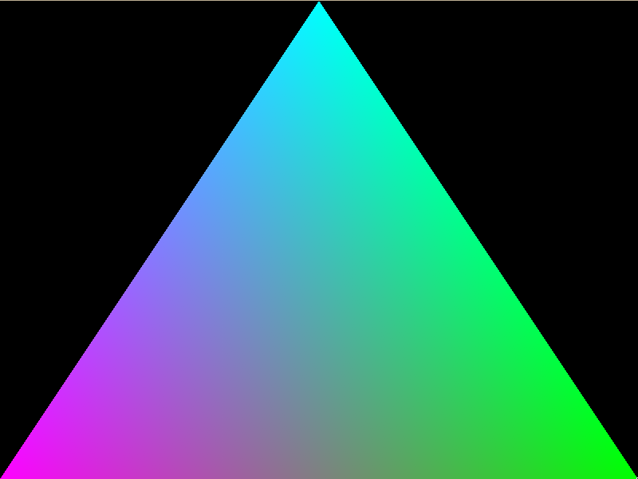
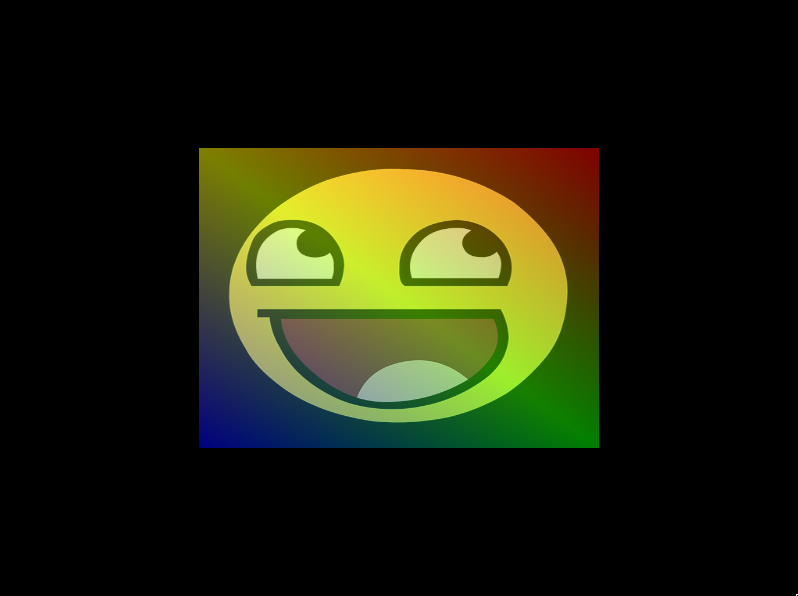
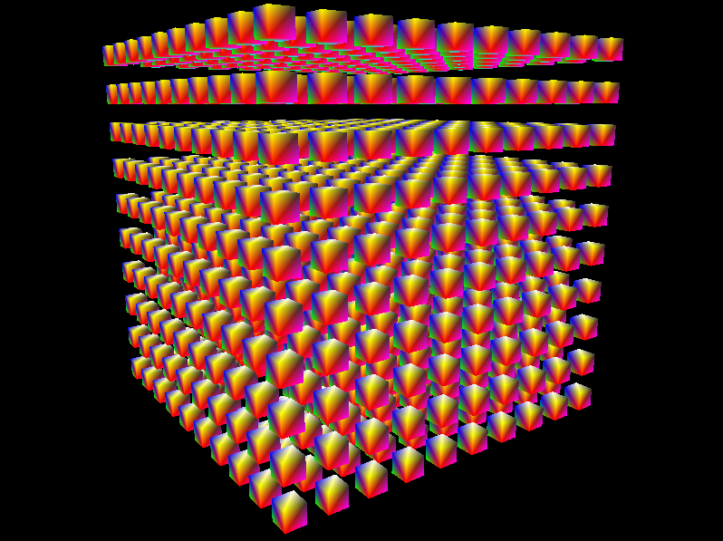
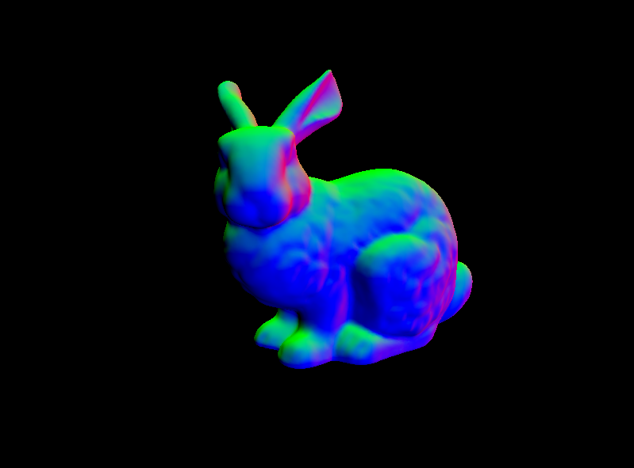
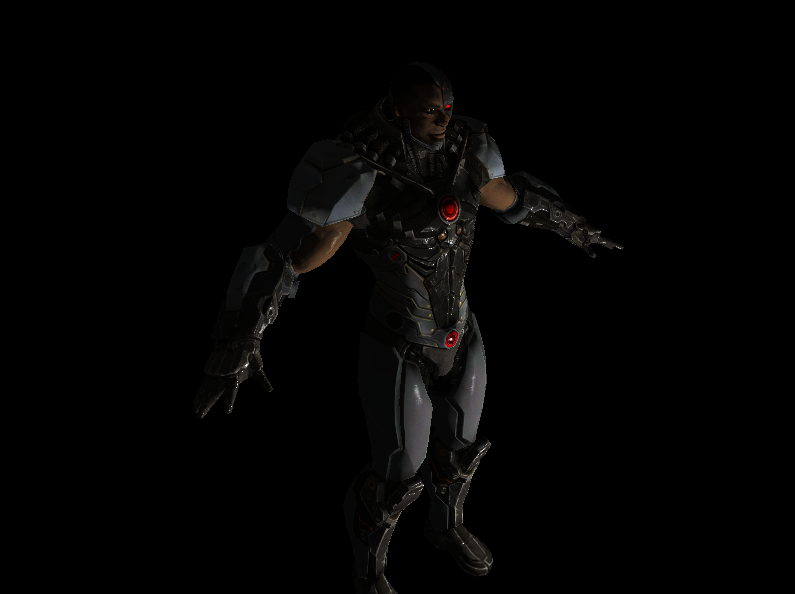
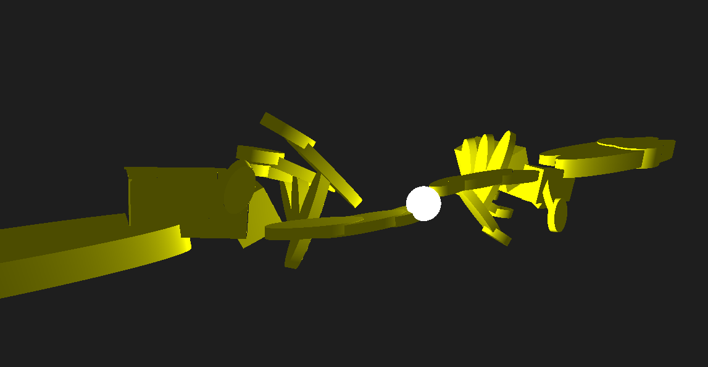

# Easy To Use OpenGL (ETU-OpenGL)

A lightweight, modern C++ (C++26) OpenGL 4.6 framework and wrapper designed to simplify 2D and 3D graphics rendering. **ETU-OpenGL** eliminates OpenGL boilerplate code by providing clean, RAII-based, type-safe abstractions for window management, shader programs, vertex buffer layouts, textures, materials, and 3D mesh loading.

- **Zero-Boilerplate OpenGL**: Intuitive abstractions for windows, contexts, shaders, VAO/VBO/EBO, and textures.
- **Modern C++26 & Reflection**: Integrates seamlessly with [`cpp-core-utils`](https://github.com/bigmat18/cpp-core-utils) for diagnostic logging, assertions, and variable reflection.
- **Wavefront OBJ & Materials Support**: Built-in 3D model parsing (`tinyobjloader`) with support for multi-materials, PBR properties, and texture mapping.
- **Nix-First Workflow**: Hermetic builds, reproducible development shells (`nix develop`), automatic GLAD generation, and dependency management through Nix Flakes.

---

## Installation and Usage

### 1. Using Nix Flakes (Recommended)

Add `etu-opengl` as an input in your project's `flake.nix`:

```nix
{
  inputs = {
    nixpkgs.url = "github:NixOS/nixpkgs/nixos-unstable";
    flake-utils.url = "github:numtide/flake-utils";
    etu-opengl.url = "github:bigmat18/etu-opengl";
  };

  outputs = { self, nixpkgs, flake-utils, etu-opengl }:
    flake-utils.lib.eachDefaultSystem (system:
      let
        pkgs = import nixpkgs { inherit system; };
        etuOpenGL = etu-opengl.packages.${system}.default;
      in {
        devShells.default = pkgs.mkShell {
          packages = with pkgs; [ gcc cmake ninja pkg-config ];
          buildInputs = [ etuOpenGL ];
        };
      }
    );
}
```

In your downstream `CMakeLists.txt`:

```cmake
cmake_minimum_required(VERSION 3.28)
project(my_opengl_app LANGUAGES CXX)

set(CMAKE_CXX_STANDARD 26)
set(CMAKE_CXX_STANDARD_REQUIRED ON)

find_package(etu-opengl CONFIG REQUIRED)

add_executable(my_opengl_app main.cpp)
target_link_libraries(my_opengl_app PRIVATE etu-opengl::etu-opengl)
```

In your C++ code:

```cpp
#include <Window.hpp>
#include <VertexArray.hpp>
#include <Program.hpp>

int main() {
    etugl::Window window = etugl::WinNoCamera();
    while (!window.is_closed()) {
        glClear(GL_COLOR_BUFFER_BIT);
        window.swap();
        glfwPollEvents();
    }
}
```

---

### 2. Standalone CMake (Manual Installation)

#### Prerequisites
- **Compiler**: GCC 16+ supporting C++26 static reflection (`-freflection`) and experimental standard library features (`libstdc++exp`).
- **CMake**: 3.28 or newer.
- **Build System**: [Ninja](https://ninja-build.org/) or Make.
- **Dependencies**: `glfw3`, `glm`, `tinyobjloader`, `stb`, `OpenGL` (`libglvnd`), `pkg-config`, and [`cpp-core-utils`](https://github.com/bigmat18/cpp-core-utils).

#### Building and Installing
```bash
# Configure and build the library
cmake -B build -S . -GNinja -DETUGL_BUILD_EXAMPLES=OFF
cmake --build build

# Install to system (or custom CMAKE_INSTALL_PREFIX)
sudo cmake --install build
```

Then in downstream projects, use `find_package(etu-opengl CONFIG REQUIRED)`.

---

### 3. Development Workflow

To develop, contribute, or run the examples in this repository using Nix:

1. **Enter the Reproducible Shell**:
   ```bash
   nix develop
   ```
   > Entering the development shell automatically populates the `external/` directory with symlinks to all dependencies (`external/glad`, `external/glm`, `external/tinyobjloader`, `external/stb`, `external/cpp-core-utils`, `external/glfw`, and `external/nlohmann_json`) for IDE autocompletion and inspection.

2. **Build the Library Package with Nix**:
   ```bash
   nix build
   ```

3. **Build and Run Examples in DevShell**:
   ```bash
   cmake -B build -S . -GNinja -DETUGL_BUILD_EXAMPLES=ON
   cmake --build build

   # Run an example
   ./build/examples/01-hello-triangle/01-hello-triangle
   ```

---

## Examples

The repository includes a collection of progressive examples demonstrating the library features:

### 1. `01-hello-triangle`
Basic window initialization, VAO/VBO setup with per-vertex color layout, shader compilation and linking, and rendering a 2D colored triangle.



---

### 2. `02-texture`
Loading image files via `stb_image`, binding `Texture2D` instances with configurable filtering and wrapping modes, and mapping UV coordinates onto a textured quad.



---

### 3. `03-ncubes`
3D perspective rendering with depth testing (`GL_DEPTH_TEST`), interactive camera controls (`WinPerspective`), and dynamic model transformations for multiple rotating 3D cubes.




---

### 4. `04-mesh-loading`
Loading and rendering complex 3D Wavefront `.obj` geometries (such as the Stanford Bunny) using `etugl::Model`, with automatic vertex attribute extraction and MVP (Model-View-Projection) matrices.



---

### 5. `05-materials`
Advanced 3D rendering supporting multiple materials per mesh, texture maps (diffuse, specular, normal, roughness, emissive), face culling (`GL_CULL_FACE`), and camera-relative Blinn-Phong lighting.



---

### 6. `06-raymarching`
Interactive Constructive Solid Geometry (CSG) scene renderer using Signed Distance Fields (SDF) and screen-space raymarching in GLSL shaders. Parses complex scene hierarchies and primitives from JSON assets (`assets/`), supporting boolean operations (union, intersection, subtraction), smooth blends, transforms, and Blinn-Phong lighting.

> **Credits**: Developed during the STAG 2025 conference hackathon with co-author [Davide Fantasia](https://github.com/DavideFantasia) (scene design and 3D modeling of "The Creation of Adam" CSG scene).


